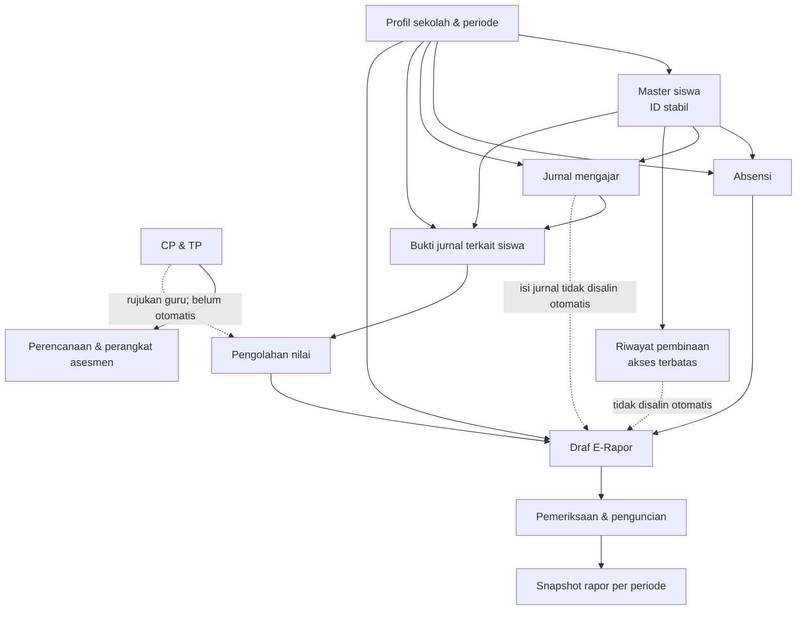

# Peta Ekosistem RuangKelas

Dokumen acuan integrasi seluruh fitur agar RuangKelas menjadi pegangan kerja guru dari persiapan pembelajaran sampai pelaporan. Dokumen ini adalah rancangan pengembangan, bukan pernyataan bahwa semua modul telah aktif.

## 1. Alur kerja terpadu

```text
Profil Sekolah + Tahun Ajaran + Semester + Kelas + Master Siswa
                         |
CP/TP + Kurikulum ------> Perangkat Ajar (RPP/Modul, ATP, Prota/Promes)
                         |
                         +--> LKPD / Bahan Ajar / Media / Bank Materi
                         |
                         +--> Jurnal Mengajar dan Refleksi
                         |
                         +--> Asesmen / Bank Soal / Kisi-kisi / Rubrik
                                      |
                                      v
                              Bukti dan Hasil Nilai
                                      |
Absensi + Catatan Wali Kelas ------> Pengolahan Nilai
                                      |
                                      v
                                  E-RAPOR
                                      |
                     Pratinjau -> Verifikasi -> Pengesahan
                                      |
                         Snapshot Semester + Arsip PDF
                                      |
                                      v
                         Pusat Kesiapan Dokumen Guru
```

## 2. Modul produk

| Modul | Fungsi | Terhubung ke |
|---|---|---|
| Profil & Kalender Akademik | Identitas sekolah/guru, tahun ajaran, semester, kelas | Semua modul dan dokumen |
| Master Siswa | Satu identitas siswa, status aktif/arsip, riwayat kelas | Absensi, pembinaan, nilai, rapor |
| CP & TP | Referensi kurikulum dan tujuan | Perangkat, LKPD, asesmen, rapor |
| Perangkat Ajar | RPP, Modul Ajar, ATP, Prota, Promes | CP/TP, jurnal, asesmen |
| Pusat Materi | LKPD, bahan ajar, media, referensi | Perangkat dan asesmen |
| Studio AI Guru | Draf terarah yang ditinjau guru | Perangkat, asesmen, LKPD, deskripsi rapor |
| Jurnal Mengajar | Pelaksanaan dan refleksi | Perangkat dan bukti pembelajaran |
| Penilaian & Bank Soal | Kisi-kisi, soal, rubrik, hasil asesmen | CP/TP, nilai, E-Rapor |
| Absensi | Kehadiran berdasarkan tanggal dan kelas | Master siswa, rekap rapor |
| Catatan & Pembinaan | Observasi faktual dan tindak lanjut | Riwayat siswa; akses terbatas |
| Pengolahan Nilai | Rekap komponen dan capaian | Bukti asesmen, E-Rapor |
| E-Rapor | Laporan individual per semester | Master siswa, mapel, nilai, absensi |
| Pusat Kesiapan Dokumen | Checklist dan pencarian dokumen yang diminta | Semua modul |
| Pengembangan Profesi & Laboratorium Media | Portofolio dan aktivitas pengembangan guru | Berdiri sebagai ruang pendukung |

## 3. Aturan agar guru tidak keliru saat diminta dokumen

Setiap dokumen yang dihasilkan harus menampilkan:
- nama dokumen dan jenisnya;
- nama sekolah, kelas, mata pelajaran, tahun ajaran, dan semester yang relevan;
- tanggal dibuat/diperbarui dan sumber data;
- status: draf, perlu diperiksa, diverifikasi, disahkan, atau arsip;
- penanda data contoh/lokal jika bukan data produksi;
- peringatan bila kolom wajib belum lengkap atau sumber belum diverifikasi.

Checklist pemeriksaan sebelum menyerahkan dokumen:
1. Identitas sekolah, guru, kelas, dan periode benar.
2. Versi kurikulum, CP/TP, dan ATP/KOSP sesuai dokumen sekolah.
3. Tujuan, kegiatan, dan asesmen saling selaras.
4. Nilai berasal dari bukti yang benar dan sudah diperiksa.
5. Absensi memakai periode yang tepat.
6. Deskripsi rapor faktual, tidak mengarang, dan telah disunting guru.
7. Catatan privat pembinaan tidak otomatis muncul pada rapor.
8. Dokumen sudah diperiksa tata letak, tanggal, dan tanda tangan/pengesahan.
9. Arsip final tersimpan dan dapat dipulihkan.

## 4. E-Rapor sebagai modul mandiri

E-Rapor memiliki navigasi, halaman kerja, konfigurasi, pratinjau, dan cetak sendiri. Namun tidak memiliki master siswa atau master nilai duplikat. Ia membaca data melalui ID yang sama dan menyimpan snapshot hasil final.

Fitur target:
- konfigurasi identitas sekolah, periode, kelas, mapel, wali kelas, dan penandatangan;
- komponen/bobot penilaian yang dapat dikonfigurasi sesuai kebijakan sekolah;
- input manual dan impor XLSX/CSV dengan pemetaan kolom, preview, validasi, duplikasi, dan konfirmasi;
- ringkasan capaian per mapel/tujuan dan deskripsi berbasis bukti;
- rekap kehadiran, ekstrakurikuler, prestasi, dan catatan wali kelas;
- pratinjau per siswa, cetak individual, cetak satu kelas, dan ekspor PDF;
- status draf → diperiksa → disahkan/dikunci;
- snapshot final dan revisi dengan riwayat perubahan;
- backup/restore dan ekspor data yang dapat dibaca kembali.

Format dan rumus nilai tidak boleh diasumsikan seragam nasional. Pengaturan harus dapat disesuaikan dengan kurikulum, kebijakan, dan format rapor sekolah. Sistem tidak boleh mengklaim dokumen resmi tanpa verifikasi dan pengesahan sekolah.

## 5. Sumber data tunggal

Gunakan ID stabil untuk school, academicPeriod, class, student, subject, learningObjective, assessment, dan report. Jangan menggunakan nama sebagai kunci relasi. Perubahan nama, kenaikan kelas, atau perubahan rombel tidak boleh merusak relasi histori.

Semua input impor melewati staging: file → pemetaan kolom → preview → validasi → konfirmasi → catat hasil. Tidak boleh menimpa seluruh data tanpa pratinjau dan backup.

## Implementasi integrasi awal (2026-11)

- Navigasi dan halaman **Pusat Data Terpadu** sudah ditambahkan ke aplikasi.
- Fondasi `workspace` menyimpan profil acuan, identitas periode akademik, dan versi skema.
- Data siswa lama diberi `studentKey` stabil saat disimpan, tanpa mengganti ID lama atau menghapus riwayat.
- Ringkasan pusat data membaca langsung daftar siswa, absensi, jurnal, dan rekaman nilai dari store aplikasi yang sama.
- Formulir profil dan identitas kelas diselaraskan melalui jembatan kompatibilitas agar modul lama tetap berjalan.
- Ini merupakan integrasi lokal satu browser. Belum ada sinkronisasi cloud, konflik multi-perangkat, autentikasi, atau pembagian akses pengguna.

## 6. Status implementasi saat ini

- Front-end HTML/CSS/JavaScript statis.
- Sebagian data siswa, absensi, nilai, pembinaan, jurnal, dan CP/TP disimpan di localStorage.
- Studio AI baru menyusun prompt lokal; tidak ada API AI aktif.
- Belum ada database cloud, login, atau sinkronisasi lintas perangkat. E-Rapor tahap awal sudah tersedia; fitur rapor final dan revisi arsip masih dalam pengembangan.
- Jangan masukkan data siswa nyata ke demo publik. Uji fitur dengan data sintetis sampai keamanan dan backup tervalidasi.

## 7. Tahap implementasi yang disarankan

1. Satukan kontrak data dan profil periode; buat ID stabil tanpa menghapus data lama.
2. Bangun E-Rapor mandiri menggunakan data lokal yang sudah ada, dengan impor/ekspor dan pratinjau.
3. Hubungkan sumber nilai dan absensi, lalu buat snapshot rapor per semester.
4. Tambahkan pusat kesiapan dokumen dan checklist administrasi.
5. Uji migrasi, arsip, kenaikan kelas, pemulihan, dan cetak dengan data sintetis.
6. Baru rancang backend, login, dan sinkronisasi dengan aturan akses serta backup yang diuji.

## 8. Prinsip hak cipta dan sumber

Referensi eksternal boleh dipelajari sesuai izin dan lisensi yang berlaku. Catat nama proyek, URL, pemilik, lisensi, bagian yang digunakan, perubahan, dan atribusi. Jangan memasukkan dataset siswa, dokumen, gambar, atau aset pihak lain tanpa hak penggunaan yang jelas.


## Implementasi E-Rapor awal (2026-11)

- Halaman E-Rapor berdiri sendiri pada navigasi RuangKelas.
- Draf per siswa menyalin identitas, periode, nilai yang sudah terikat periode, dan rekap kehadiran.
- Catatan wali kelas pada draf dapat diedit; catatan pembinaan privat tidak diambil.
- Snapshot dapat dikunci per siswa dan periode agar tidak ikut berubah ketika nilai sumber diedit.
- Nilai lama yang belum memiliki penanda periode tidak dimasukkan otomatis. Guru perlu memeriksa dan menyimpan ulang nilai pada periode yang benar.
- Pengolahan nilai kini memisahkan rekaman berdasarkan periode aktif.
- Cetak daftar rapor tersedia melalui dialog cetak browser. Format ini masih kerangka awal, bukan pengganti format rapor resmi sekolah.
- Belum tersedia revisi snapshot terkunci, impor XLSX langsung, komponen bobot fleksibel, deskripsi capaian berbasis CP/TP, serta cetak PDF individual final.


### Impor nilai E-Rapor (tahap awal)
- E-Rapor kini menyediakan impor nilai berbasis CSV dengan pemetaan kolom nama siswa/NISN, mata pelajaran, dan nilai.
- Sistem menampilkan pratinjau, jumlah baris siap impor, dan baris yang dilewati sebelum konfirmasi.
- Pencocokan siswa menggunakan nama atau kode/NISN yang sama persis; nilai harus 0–100.
- Rekaman nilai yang sudah ada pada siswa, mapel, dan periode yang sama tidak ditimpa. Baris duplikat/invalid dilewati.
- XLSX langsung, pemetaan nilai berbobot, dan uji browser masih menjadi pekerjaan berikutnya. Untuk file Excel, simpan/ekspor dahulu sebagai CSV UTF-8.
- Data tetap tersimpan lokal di browser; lakukan cadangan data sebelum impor besar.


## Pembaruan status audit (2026-11-04)
- E-Rapor tahap awal telah memiliki impor CSV dengan pemetaan kolom, pratinjau, validasi dasar, pencocokan nama/kode siswa, dan perlindungan dari overwrite. Impor XLSX langsung belum tersedia.
- Pusat Data Terpadu membaca data lokal dari store aplikasi dan menjadi ringkasan/kompatibilitas; belum menjadi layanan database atau sinkronisasi cloud.
- Semua modul yang telah ada dipertahankan. Modul katalog seperti Perangkat Ajar, Penilaian, dan Pusat Materi belum seluruhnya berupa editor dokumen lengkap.
- Status implementasi, kontrak localStorage, dan aturan migrasi aman yang lebih rinci mengikuti [ARSITEKTUR.md](ARSITEKTUR.md).


## 9. Skema visual aliran data dan batas integrasi

Diagram berikut menjelaskan arah aliran data saat ini. Panah menunjukkan sumber yang dibaca atau hasil yang disalin, bukan berarti seluruh modul sudah memakai satu layanan backend.



### Cara membaca skema

| Kelompok | Fungsi | Batas saat ini |
|---|---|---|
| Profil & periode | Acuan sekolah, guru, kelas, semester, tahun ajaran | Tersimpan lokal pada browser |
| Master siswa | Identitas tunggal dan relasi histori | ID lama dipertahankan; `studentKey` dipakai untuk relasi baru |
| Absensi | Rekap kehadiran per siswa/periode | Data harus diperiksa dan sesuai periode sebelum masuk rapor |
| Jurnal mengajar | Catatan pelaksanaan pembelajaran | Bisa umum atau ditautkan ke seorang siswa |
| CP & TP | Rujukan kurikulum dan tujuan | Guru memilih dan memvalidasi; belum otomatis mengubah nilai |
| Penilaian | Nilai mapel per siswa/periode dan tinjauan bukti jurnal | Nilai tetap ditetapkan guru; bukti jurnal tidak menghasilkan angka otomatis |
| Pembinaan | Catatan privat dan tindak lanjut | Tidak otomatis menjadi isi rapor |
| E-Rapor | Draf, pemeriksaan, dan snapshot | Menyalin ringkasan nilai/kehadiran; isi jurnal dan pembinaan tidak disalin otomatis |

### Status hubungan

- **Terhubung langsung:** modul yang membaca/menulis store utama yang sama pada browser ini.
- **Terhubung sebagai referensi:** CP/TP dan perangkat asesmen menjadi rujukan guru, bukan sumber nilai otomatis.
- **Tinjauan manual:** guru membuka bukti jurnal, memeriksa relevansi, lalu menetapkan nilai atau deskripsi.
- **Snapshot:** rapor yang dikunci menyimpan keadaan pada saat dikunci dan tidak mengikuti perubahan data sumber.
- **Belum tersedia:** database cloud, login multi-peran, sinkronisasi lintas perangkat, revisi snapshot terkunci, dan audit trail penuh.

Skema ini harus diperbarui setiap kali kontrak data atau alur modul berubah. Tampilan visual yang dapat diklik tersedia pada halaman **Pusat Data Terpadu** di dalam aplikasi.


## 10. Panduan visual per modul

Halaman inti menggunakan pola panduan tiga langkah agar urutan kerja terlihat konsisten tanpa mengubah aturan penyimpanan:

| Modul | Urutan kerja yang ditampilkan | Makna status / batas |
|---|---|---|
| Absensi & Siswa | Pastikan daftar → pilih tanggal → lengkapi status | “Belum diisi” berarti status siswa untuk tanggal terpilih belum ditetapkan |
| Jurnal Mengajar | Catat pelaksanaan → tautkan siswa bila relevan → tulis bukti/refleksi | Siswa terkait bersifat opsional; jurnal kelas tidak otomatis menjadi bukti individual |
| Pengolahan Nilai | Tentukan mapel/periode → isi nilai mentah → tinjau bukti | Nilai akhir adalah hasil rumus tampilan; guru tetap memeriksa dan bertanggung jawab atas nilai |
| E-Rapor | Pastikan periode → buat/periksa draf → kunci | Draf merupakan salinan; snapshot terkunci tidak berubah otomatis |
| Pembinaan | Catat fakta → sepakati tindakan → pantau status | Data terbatas; tidak dikirim otomatis ke rapor |

Panduan ini bersifat penjelas, bukan validasi tambahan. Tidak ada langkah baru yang menghalangi guru menggunakan modul. Kontrol yang sudah ada tetap menjadi sumber kebenaran; panduan tidak membuat status data baru.


## 11. Ringkasan operasional jurnal

Jurnal mengajar menampilkan empat angka ringkas yang dihitung dari catatan tersimpan:

- **Total jurnal:** seluruh catatan jurnal yang tersedia pada perangkat.
- **Jurnal periode aktif:** catatan yang memiliki `periodId` sama dengan periode aktif. Catatan lama tanpa penanda periode tidak dihitung ke angka ini.
- **Bukti individual:** catatan yang memiliki relasi siswa melalui `studentKey` atau `studentId`.
- **Catatan seluruh kelas:** total jurnal dikurangi catatan individual.

Angka ini adalah ringkasan navigasi, bukan penilaian kinerja siswa. Jurnal yang tidak memiliki periode tetap tersedia pada riwayat, tetapi tidak otomatis dianggap sebagai bukti periode berjalan.


## 11. Ringkasan operasional di dashboard

Modul Jurnal Mengajar menampilkan total jurnal tersimpan, jumlah jurnal pada periode aktif, jumlah catatan yang tertaut ke siswa, dan catatan tingkat kelas. Pengolahan Nilai menampilkan jumlah siswa aktif, jumlah yang sudah memiliki nilai pada mapel/periode terpilih, jumlah yang belum dinilai, serta rata-rata nilai akhir.

Angka ringkasan dihitung dari data yang sudah tersimpan dan mengikuti filter konteks modul. Ringkasan tidak membuat atau mengubah rekaman nilai/jurnal. Jika guru mengganti mapel atau periode, ringkasan penilaian mengikuti konteks aktif saat modul dirender.

## 12. Cetak daftar E-Rapor

- Tombol **Cetak daftar rapor** membuka tampilan cetak khusus E-Rapor, bukan halaman absensi.
- Format cetak dioptimalkan untuk kertas A4 lanskap: identitas sekolah/periode, ringkasan jumlah siswa/draf/rapor terkunci/nilai, lalu tabel rekap per siswa.
- Navigasi, impor CSV, panduan kerja, dan tombol tindakan disembunyikan saat mencetak. Catatan wali kelas tetap ditampilkan sebagai teks; kolom yang belum diisi tetap kosong untuk pemeriksaan.
- Cetak daftar adalah rekap administrasi kelas, bukan pengganti lembar rapor individual resmi. Pastikan identitas sekolah dan isi catatan sudah benar sebelum mencetak.
- Status draf dan snapshot terkunci tidak diubah oleh proses cetak. Snapshot terkunci tetap tidak dapat diedit; data pembinaan privat dan isi jurnal tidak ditambahkan ke hasil cetak.

## 13. CP dan pemetaan tema Bahasa Indonesia kelas VI

- Data Bahasa Indonesia Fase C memuat tiga uraian elemen yang disalin dari bahan guru: Menyimak, Membaca dan Memirsa, serta Berbicara dan Mempresentasikan. Uraian elemen ketiga berhenti pada kalimat “logis, sistematis, efektif” karena sumber yang dikirim terpotong; aplikasi menandai keterbatasan itu dan tidak mengarang kelanjutannya.
- Ringkasan CP acuan tetap menampilkan empat elemen, termasuk Menulis, berdasarkan ringkasan CP Fase C yang sudah ada di data kurikulum. Uraian lengkap Menulis tidak ditambahkan karena tidak ada dalam potongan bahan yang dikirim.
- Pemetaan tema Bahasa Indonesia kini mencakup Bab I sampai Bab V. Fokus kebahasaan Bab I–IV mengikuti daftar guru; Bab V memuat dua fokus yang tersedia, yaitu peta berpikir dan menulis alur/kutipan tokoh.
- Bab V baru memiliki pengantar tema yang terpotong. Karena itu deskripsi tema dan TP Bab V di aplikasi diberi status sebagai ringkasan kerja sementara, bukan kutipan lengkap dari buku.
- Fokus kebahasaan tampil terpisah dari TP/urutan tujuan dan materi pokok. Pencarian kurikulum juga mencakup fokus kebahasaan agar guru dapat menemukan bab berdasarkan istilah materi.
- Penambahan ini hanya memperkaya referensi CP/TP lokal kelas VI. Tidak mengubah nilai, rapor, absensi, jurnal, maupun data siswa. Guru tetap dapat menyunting TP dan pemetaan elemen CP sesuai ATP/KOSP sekolah.


## 14. Integrasi otomatis CP → TP → materi → perangkat ajar → asesmen

- Data `assets/kurikulum-kelas6.js` menjadi sumber bersama untuk CP, bab, TP, materi pokok, dan fokus kebahasaan. Perangkat Ajar, Penilaian, dan Pusat Materi menampilkan kartu bab yang terhubung langsung ke Studio AI; kartu bersifat dinamis dan tidak menggandakan data kurikulum ke store administrasi.
- Tombol **Susun dari kurikulum** mengisi jenis dokumen, mapel, kelas/fase, topik, CP, seluruh TP pada bab, pemetaan elemen CP otomatis, materi pokok, dan fokus kebahasaan ke Studio AI. Guru tidak perlu memilih TP satu per satu.
- Jika guru mengetik mapel dan topik langsung di Studio AI, sistem mencocokkan topik dengan judul bab, uraian, materi pokok, fokus kebahasaan, dan TP. Jika tidak ditemukan kecocokan memadai, sistem tidak memaksakan bab dan memberi catatan bahwa konteks CP/TP perlu dilengkapi.
- Pemetaan elemen CP menggunakan aturan kata kunci sesuai mata pelajaran. Hasilnya rekomendasi awal, bukan keputusan kurikulum final. Pemetaan manual lama yang tersimpan tetap dihormati sebagai override; guru tetap meninjau kesesuaian dengan ATP/KOSP.
- Kartu kurikulum bukan dokumen hasil AI dan tidak otomatis disimpan sebagai dokumen final. Kartu membuka Studio AI untuk menyusun prompt; keluaran AI tetap perlu ditinjau dan disimpan oleh guru.
- Integrasi ini tidak membaca atau menyalin catatan pembinaan, identitas siswa, nilai individual, absensi, maupun snapshot rapor. Tidak ada perubahan pada kontrak data siswa/penilaian/rapor.


## Integrasi Bank Soal Digital (2026-11-05)

- Bank Soal Digital ditambahkan sebagai modul navigasi tersendiri di RuangKelas.
- Referensi mapel, fase, kelas, bab, dan TP dibaca langsung dari dataset CP/TP dan TP tambahan lokal; pemetaan elemen CP mengikuti fungsi inferensi yang sudah digunakan aplikasi.
- Form soal mendukung pilihan ganda dan uraian, pilihan A–E, kunci/pedoman jawaban, pembahasan, level kognitif C1–C6, tingkat kesulitan, dan tag tambahan.
- Pencarian serta filter mapel, kelas/fase, bentuk soal, dan level kognitif tersedia. Pemeriksaan duplikasi membandingkan teks pertanyaan yang dinormalisasi dalam mapel yang sama dan meminta konfirmasi bila ditemukan kecocokan.
- Soal dapat diedit/dihapus, dipilih dari tabel, dirakit menjadi paket, lalu dicetak sebagai lembar soal atau soal beserta halaman kunci/pembahasan terpisah.
- Statistik jumlah soal per TP ditampilkan pada modul. Ekspor CSV tersedia.
- Penyimpanan soal menggunakan kunci lokal terpisah `ruangkelas-bank-soal-v1`; tidak menautkan soal ke identitas siswa, nilai, absensi, atau catatan pembinaan. Backup penuh RuangKelas yang menyalin seluruh kunci `ruangkelas-*` turut mencakup data Bank Soal.
- Batas tahap ini: data masih lokal pada browser, belum tersimpan di Google Sheets, belum ada sinkronisasi antarperangkat/role multi-guru, dan cetak paket memakai dialog cetak browser (bukan pembuatan Google Docs otomatis). Sumber CP/TP tetap perlu diverifikasi guru.
